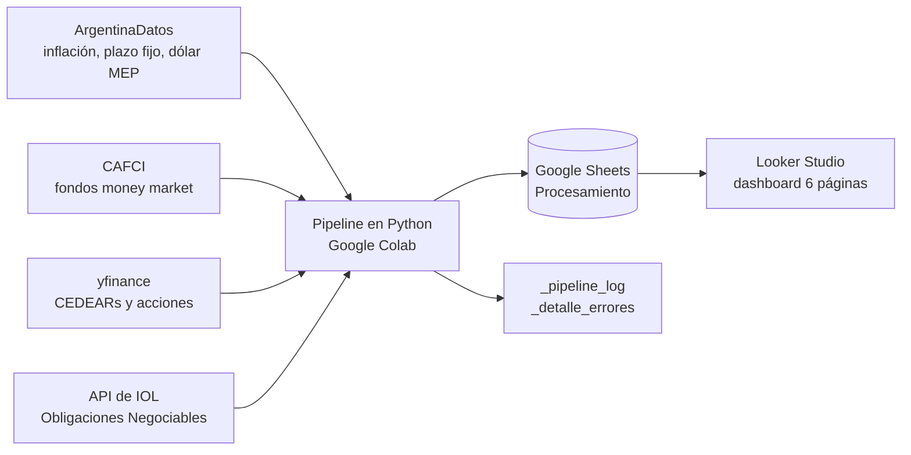

# Inversiones vs. Inflación: ¿qué alternativa protegió mejor el poder adquisitivo en Argentina?

Proyecto de **ingeniería de datos y analítica**: un pipeline en Python (Google Colab) consume cuatro fuentes de datos, calcula el rendimiento nominal y **real** (descontando inflación) de 8 categorías de ahorro e inversión en ventanas de 1, 3, 6 y 12 meses, consolida los resultados en Google Sheets y los expone en un dashboard de Looker Studio de 6 páginas.

> **Aviso:** proyecto personal con fines de práctica en análisis de datos. Refleja el comportamiento histórico del período analizado y **no constituye asesoramiento financiero**.

## La pregunta

¿Cuánto rindió, en términos reales, cada alternativa de ahorro e inversión disponible para un argentino (plazo fijo, fondos comunes, CEDEARs, acciones locales, acciones de EE.UU. y Obligaciones Negociables)?

## Principales hallazgos

- **Rendimiento real positivo:** acciones de EE.UU. (+9,91%) y CEDEARs (+7,39%).
- **En línea con la inflación, con alta dispersión:** acciones locales argentinas (−0,28% en promedio), con instrumentos individuales que perdieron hasta −29,21% en términos reales (GGAL).
- **Pérdida real sostenida:** plazo fijo (−2,40%), fondos comunes de inversión (−2,87%) y Obligaciones Negociables (−6,72%, la categoría con peor desempeño promedio).
- **Exposición a EE.UU.:** convertida a pesos con el dólar MEP, fue la categoría con mejor desempeño relativo. Los cuatro instrumentos analizados (NVDA, TSLA, SPY, AMZN) rindieron entre 23,79% y 102,89% en dólares a 12 meses, lo que se tradujo en ganancias reales significativas en pesos.
- **Renta fija en pesos:** tasas nominales positivas, pero por debajo de la inflación. A 12 meses, la brecha real varía entre −4,72% y −6,53% según el instrumento.
- **Obligaciones Negociables:** las cinco analizadas rindieron por debajo de la inflación a 12 meses, con pérdidas reales de entre −10,19% y −16,37%.
- **Visión general:** en las cuatro ventanas (1, 3, 6 y 12 meses), la mayoría de los instrumentos analizados no superó la inflación.

El patrón sugiere que los activos de crecimiento o denominados en moneda extranjera protegieron mejor el poder adquisitivo que la renta fija en pesos durante el período, con la salvedad de que la renta variable implica mayor dispersión de resultados.

## Arquitectura

## Stack

- **Procesamiento:** Python (pandas, requests, yfinance), Google Colab
- **Almacenamiento:** Google Sheets (`gspread`)
- **Visualización:** Looker Studio

## Fuentes de datos

- **ArgentinaDatos:** inflación mensual, tasa de depósitos a 30 días (BCRA) y dólar MEP histórico.
- **CAFCI:** rendimientos de fondos de mercado de dinero (Cocos Ahorro, Mercado Fondo, Ualintec Ahorro Pesos).
- **yfinance:** CEDEARs y acciones locales (tickers con sufijo `.BA`) y acciones de EE.UU.
- **API de IOL:** series históricas de Obligaciones Negociables.

## Metodología

- **Ventanas:** 1, 3, 6 y 12 meses, para todas las categorías.
- **Rendimiento real:** `(1 + rendimiento nominal) / (1 + inflación del período) − 1`.
- **Dos ejes de análisis:** los instrumentos en pesos se comparan directamente contra la inflación argentina. Las acciones de EE.UU. se muestran en dólares como tabla informativa y, para compararlas contra la inflación, se convierten a pesos con el dólar MEP: `(1 + rendimiento USD) × (1 + variación del dólar MEP) − 1`. Estas filas se marcan con el indicador `instrumento_dolarizado`.
- **Fondos de mercado de dinero:** el rendimiento del período se deriva de la TNA publicada (`TNA × días / 365`).
- **Obligaciones Negociables y acciones:** variación de precio entre la fecha inicial y la final de cada ventana. Si el dato más cercano a la fecha objetivo está a más de 15 días, el instrumento no existía en esa ventana y se registra como sin dato, en lugar de anclarlo al primer valor disponible.

## Enfoque de ingeniería de datos

- **Resiliencia:** reintentos con espera progresiva en todas las llamadas a APIs.
- **Observabilidad:** log por corrida en `_pipeline_log` y detalle por ítem fallido (función, ítem, tipo de error) en `_detalle_errores`, que se escribe una sola vez al final del pipeline y solo si hubo errores.
- **Contrato de datos:** todos los rendimientos se guardan como fracción decimal (`0.1656`, no `16.56`) y el formato porcentual se aplica en la capa de presentación, para mantener una única fuente de verdad.
- **Consolidación:** una tabla final (`Rendimiento_Consolidado`) con las categorías comparables contra inflación y otra aparte en USD, solo informativa.
- **Secretos:** las credenciales de IOL no se guardan en el notebook ni en el repositorio. El token de IOL dura 15 minutos y se solicita de nuevo antes de cada tanda de consultas.

## Decisiones y aprendizajes

- **API de CAFCI discontinuada:** la API anterior, que usaba ArgentinaDatos, dejó de funcionar en abril de 2026 y los endpoints por fecha devolvían 404. Se migró a los endpoints nuevos de CAFCI, que requieren un `User-Agent` de navegador para no ser bloqueados.
- **De IAMC a IOL para las ONs:** los informes públicos de IAMC solo ofrecían historia desde junio de 2026 y el sitio restringe el acceso automatizado, por lo que se descartó esa fuente. IOL ofrece series históricas completas y permitió igualar la profundidad temporal del resto de las categorías.
- **Comparabilidad de monedas:** un rendimiento en USD no es comparable contra inflación en pesos. Por eso se dolarizan las acciones de EE.UU. con el dólar MEP y se mantiene la versión en USD aparte.
- **Sin activos duplicados:** un mismo activo no aparece en dos categorías con significados distintos.

## Dashboard (Looker Studio)

1. **Resumen ejecutivo:** objetivo del análisis, tarjetas de instrumentos destacados, rendimiento real por categoría y cantidad de instrumentos que superaron o no la inflación en cada ventana, con filtro por categoría.
2. **Renta fija en pesos:** plazo fijo y fondos comunes. Rendimiento a 12 meses por instrumento y tabla de rendimiento vs. inflación por ventana, con formato condicional.
3. **Renta variable argentina:** CEDEARs y acciones locales. Tarjetas de instrumentos destacados, rendimiento real por instrumento y por período.
4. **Obligaciones Negociables:** rendimiento real por período y tabla de rendimiento vs. inflación.
5. **Acciones de EE.UU.:** "Exposición a EE.UU.: en pesos vs. en dólares". Rendimiento real en pesos por período (vía dólar MEP) y tabla con el rendimiento en dólares.
6. **Conclusión:** top 5 de instrumentos individuales y lectura por categoría.

## Limitaciones conocidas

- **Muestra reducida:** entre 3 y 5 instrumentos por categoría, elegidos por representatividad y disponibilidad de datos. No representa el universo completo ni garantiza que otro activo de la misma categoría se comporte igual.
- **Obligaciones Negociables sin cupones:** el rendimiento se calcula sobre el precio sin ajustar, por lo que no incluye los cupones cobrados y subestima el retorno total de las ONs.
- **Instrumentos recientes:** una ON emitida hace menos de 12 meses no tiene dato en las ventanas más largas.
- **Fondos:** el rendimiento se deriva de la TNA publicada, no de la variación del valor de la cuotaparte.
- **Un solo período:** los resultados describen una ventana puntual y no un ciclo completo. El rendimiento pasado no anticipa el futuro.
- **Sin impuestos ni comisiones:** los rendimientos son brutos.
- **Inflación general:** se usa el índice agregado, no la canasta de cada persona.

## Próximos pasos

- [ ] Programar la ejecución del pipeline para que no dependa de una corrida manual en Colab.
- [ ] Incorporar cupones y dividendos para calcular retorno total.
- [ ] Ampliar la muestra por categoría y balancear emisores en las ONs.
- [ ] Agregar pruebas automáticas de calidad de datos antes de escribir a Sheets.
- [ ] Agregar un segundo benchmark (por ejemplo, dólar oficial) además de la inflación.

## Cómo reproducirlo

1. Abrí el notebook en Google Colab.
2. Guardá las credenciales de IOL en los **Secretos de Colab**, sin escribirlas en el código.
3. Autenticá tu cuenta de Google (`google.colab.auth` + `gspread`) y creá un Sheet llamado `Procesamiento`.
4. Ejecutá las celdas en orden: el pipeline escribe `Rendimiento_Consolidado`, `_pipeline_log` y `_detalle_errores`.
5. Conectá Looker Studio al Sheet y armá las páginas del dashboard.

---
## Autor

**Manuel Martínez** · Data Analyst
[LinkedIn](https://www.linkedin.com/in/manuelmartinez92)
